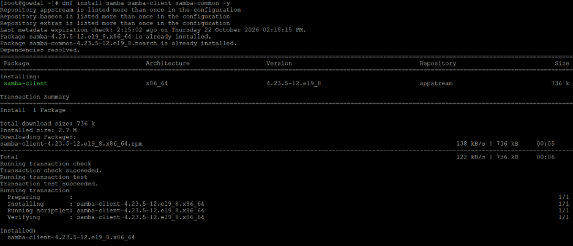
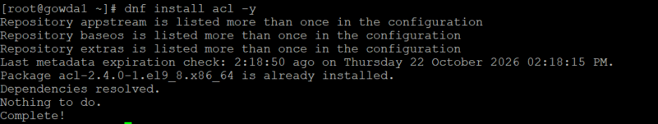
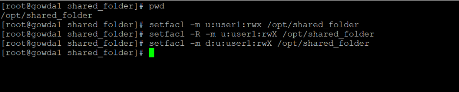
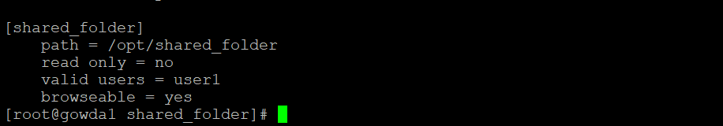
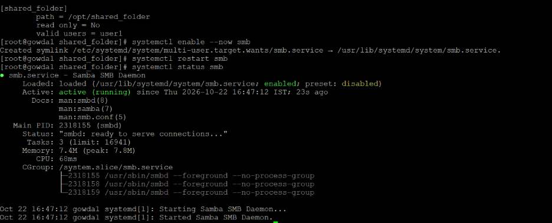
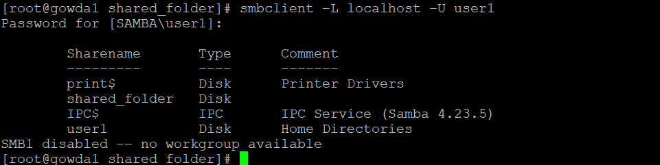
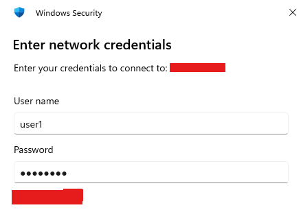
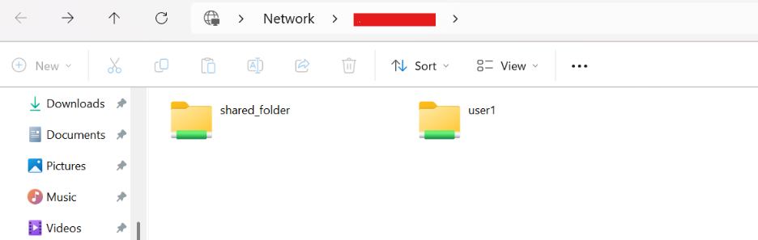

***Samba File Sharing Between Linux and Windows***
task Overview
---
This project demonstrates how to configure Samba file sharing on a Linux server and access shared directories from a Windows client. It covers Samba installation, user authentication, ACL permissions, SELinux security contexts, share configuration, and file-access validation.
---

Technologies Used
Linux Server (RHEL based distribution)
Samba
Windows Client
Access Control Lists (ACL)
SELinux
Linux user and permission management
Network file sharing

1. Samba Installation

Install the Samba server and client packages.

```
dnf install samba samba-client samba-common -y
```


2. Linux User Creation

Create a dedicated Linux user for Samba access.


```
useradd -s /sbin/nologin user1
passwd user1
smbpasswd -a user1
smbpasswd -e user1
```
useradd creates the Linux account.
passwd sets the Linux account password.
smbpasswd -a adds the user to the Samba password database.
smbpasswd -e enables the Samba account.


3. ACL Package Installation

Install ACL utilities to manage file and directory permissions.

```
dnf install acl -y
```


4. SELinux Context Configuration

Install the SELinux management utilities.

```
dnf install policycoreutils-python-utils -y
```

Add the SELinux file context rule and apply it to the shared directory.
```
semanage fcontext -a -t samba_share_t "/opt/shared_folder(/.*)?"
restorecon -Rv /opt/shared_folder
```

Verify the SELinux context.
```
ls -Zd /opt/shared_folder
```

The directory should have the samba_share_t SELinux type.


5. Folder ACL Permissions

Create the shared directory if it does not already exist.
```
mkdir -p /opt/shared_folder
```

Grant user1 read, write, and directory traversal permissions.

```
setfacl -m u:user1:rwx /opt/shared_folder
setfacl -R -m u:user1:rwX /opt/shared_folder
setfacl -m d:u:user1:rwX /opt/shared_folder
```

The default ACL helps new files and directories inherit the intended permissions, subject to normal ACL masks and file-creation rules.



Verify the permissions.

```
getfacl /opt/shared_folder
```

6. Samba Configuration

Edit the Samba configuration file.

```
vi /etc/samba/smb.conf
```

Add the following share definition.

[shared_folder]
    path = /opt/shared_folder
    browseable = yes
    read only = no
    valid users = user1


Save the file and validate the configuration.

```
testparm
```

The share name is shared_folder. Use the same name when connecting from Windows.



7. Samba Service Status

Enable Samba at boot, start the service, and verify its status.

```
systemctl enable --now smb
systemctl restart smb
systemctl status smb
```

Confirm that the service is active.



8. Samba Share Verification

List the available Samba shares from the Linux server.

```
smbclient -L localhost -U user1
```

Enter the Samba password when prompted. Verify that shared_folder appears in the output.



9. Windows Network Share
Open File Explorer.
Enter the following path in the address bar, replacing SERVER-IP with your Linux server's IP address.

\\SERVER-IP\shared_folder

Enter the Samba username and password when prompted
Confirm that the shared directory opens successfully



10. Windows File Access Test

Create a test file from Windows inside the shared directory. Then verify that it appears on the Linux server.

```
ls -l /opt/shared_folder
```

Confirm that the file is listed and that the intended read/write access works.



Troubleshooting
Check Samba service status

```
systemctl status smb
```
Validate Samba configuration

```
testparm
```
List available Samba shares
```
smbclient -L localhost -U user1

```
Check ACL permissions
```
getfacl /opt/shared_folder
```

Check SELinux context
```
ls -Zd /opt/shared_folder
```

Configure the firewall

If firewalld is active, allow Samba traffic.

```
firewall-cmd --permanent --add-service=samba
firewall-cmd --reload
```

If access fails, check Linux directory permissions, ACLs, SELinux contexts, Samba credentials, firewall rules, and network connectivity.

Key Learning Outcomes
Installing and configuring Samba on Linux.
Managing Linux users and Samba authentication.
Configuring ACL permissions for shared directories.
Applying SELinux security contexts.
Validating Samba configuration and services.
Accessing Linux shares from Windows.
Testing cross-platform file access.
Troubleshooting common file-sharing issues.

---
Conclusion

This hands-on project demonstrates Linux-to-Windows file sharing using Samba, with access control managed through Linux ACLs and SELinux.

The repository includes practical configuration commands, validation steps, troubleshooting guidance, and screenshots documenting the implementation.
--
